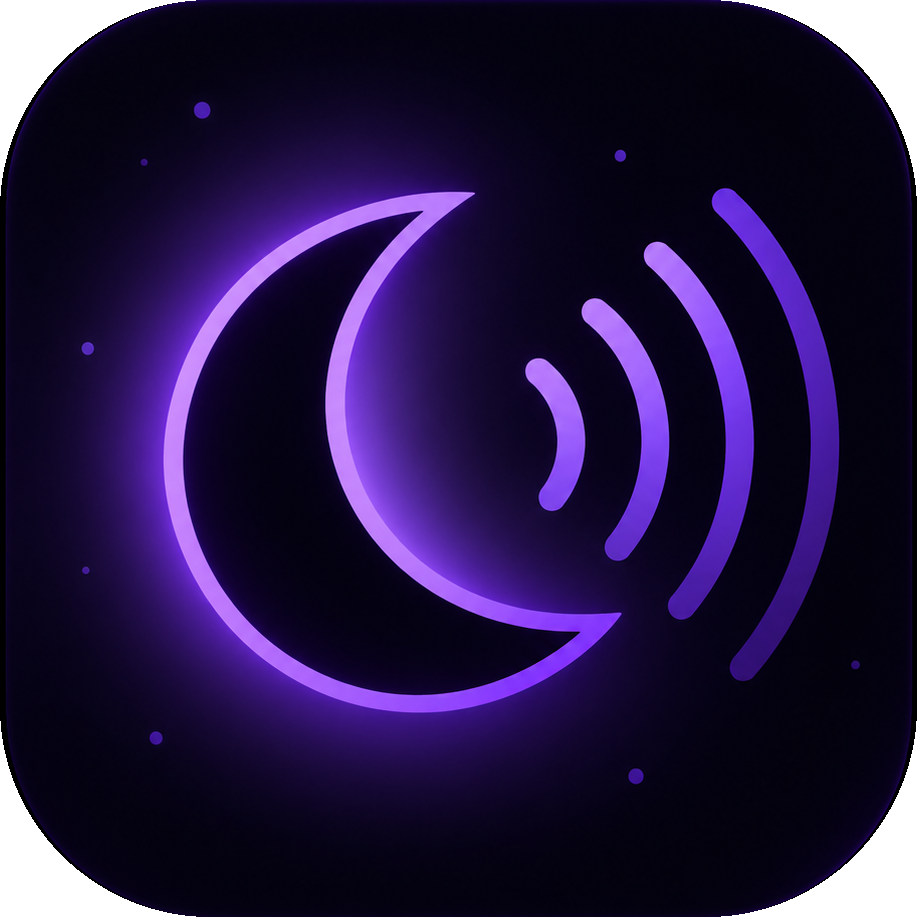

# nocturne

**nocturne** is a songwriting app with a rhyme highlighter. It brings lyric writing, rhyme tools and beat playback together in one themed desktop workspace.

> **Status:** v1.1.1


## What's New in v1.1.1
### UI & Layout

* **Full-screen layout:** Raised the floating auto-scroll panel slightly with a bottom black gradient fade so it no longer clips against the taskbar.
* **Song structure background (`[` / `@`):** Fixed the background turning transparent when typing structure tags; it now matches the active theme's background color.
* **Rhyme color bar:** Added a **Clean Up Lyrics** tool next to the rhyme color bar to format messy lyrics (capitalizing line starts, removing stray commas/periods, and adding missing structure tags).

### Vault & Song Management

* **Renaming songs:** Fixed top-bar renaming so it renames the existing lyric file in the Vault instead of creating a duplicate file. New files are now only created when clicking **New**.
* **Full Vault context menu:** Added a right-click menu with actions matching the app's features.

### Rhyme Engine, Checker & Pen Meter

* **Live mode in Rhyme Checker:** Synced Rhyme Checker with Live Mode so it automatically checks selected bars and upcoming bars as you work.
* **Broader & near-rhyme detection:** Improved rhyme detection for missed words (such as matching Malay words like *"palat"* with *"bulat"*, *"kilat"*, and *"kiblat"*) and added near-rhyme matching.
* **Slant rhymes in downloaded packs:** Expanded the **Slant** tab for downloaded packs beyond the local dictionary to include slant rhymes, near rhymes, and shared vowel or rhythm matches (e.g., *"enemies"* matching *"remedies [near]"*, *"memories"*, *"friendly"*, and *"tennis"*).
* **Match percentages on pack rhymes:** Added match score percentages to downloaded rhyme pack pills (e.g., `homies [92%]`).
* **Pen Meter:** Added near-rhyme data to the Pen Meter readout.

## Features

### Lyric editor & Rhyme tools

* Rhyme highlighting for end and internal rhymes, with optional near-rhyme underlines
* Highlighting by rhyming syllable or by whole word
* Live syllable counter for each bar, with flow cadence warnings
* Rhyme lookup with filters for English (EN), Bahasa Melayu (BM), language packs and slant rhymes
* **Rhyme Checker** for direct side-by-side phonetic comparison and rhyme score percentage
* Search within the current lyrics
* Full-screen lyric preview with auto-scroll
* Scrapbook for loose bars, hooks and ideas
* **Lyrics Analyzer** for offline craft feedback, targeted exercises, and structural planning
* PDF lyric export

### Beat player

* Load, play and loop beats
* Metronome with Off, On and Auto modes, plus 4/4, 3/4 and 6/8 time signatures
* Tap tempo and manual downbeat sync
* Timestamp markers and lyric line timestamps

### Pen Meter

* Rates your lyrics and opens a detailed scorecard

### Vault

* Save, search and reopen tracks
* Recycle bin for restoring deleted tracks

### Profiles

* Up to 9 profiles, each with a unique name
* Custom avatars
* Optional PIN lock with encryption of profile data
* Rename, duplicate, delete, back up and restore (`.zip`)

### Customization

* Dynamic UI themes (including Monochrome Noir) with automatic contrast adjustment
* Custom slang and language packs, including word list import and online search
* Editor font, size, weight and word wrap settings
* Auto-save, default BPM and default beat volume settings

## Keyboard shortcuts

| Shortcut | Action |
| --- | --- |
| `Ctrl+F` | Search in the current lyrics |
| `Ctrl+M` | Pin a marker at the current beat position |
| `Ctrl+T` | Insert a timestamp on the current lyric line |
| `Space` | Start or pause auto-scroll (full-screen preview) |
| `Esc` | Close the full-screen preview |

## Installation (Windows)

1. Run `Nocturne_Setup_1.1.0-beta.exe` (or `Nocturne_v1.1.0-beta.exe`).
2. Follow the setup wizard if using the installer.
3. Open **Nocturne** from the Start menu or the optional desktop shortcut.

The default install location is `%LOCALAPPDATA%\Programs\Nocturne`. Administrator rights are not required.

## Getting started

1. Choose a profile, or create a new one.
2. Enter a track title and start writing.
3. Load a beat from the **beat player** panel.
4. Use **Rhyme Checker** on the right panel to test two words side by side, or click **Analyze** under the scrapbook for a full craft breakdown.
5. Click **Save Track** to keep your work in the vault.

## Running from source

You need Python 3 and the project files, including `main.py` and `lyric_engine.py`.

```bash
pip install PySide6 numpy librosa
python main.py
```

[FFmpeg](https://ffmpeg.org/) is recommended. It is used as a fallback when beat audio cannot be read directly.

## Building from source (Windows)

If you want to compile the standalone executable and Windows installer yourself instead of downloading from Releases:

### 1. Build the executable

1. Double-click `build.bat`. An internet connection is required to install dependencies, and the process may take a few minutes.
2. Once finished, the compiled files will be located in `dist\Nocturne\`.
3. If you add extra dependencies to `lyric_engine.py`, append those package names to the `pip install` line inside `build.bat`.

### 2. Test before packaging

Run `dist\Nocturne\Nocturne.exe` and verify the core features:

* Create a profile and save a track
* Load an MP3 beat and test the metronome in **AUTO** mode
* Check rhymes, **Rhyme Checker**, and **Lyrics Analyzer**
* Export a PDF and create a `.zip` backup

> **Troubleshooting:** If the app closes immediately on launch, change `--windowed` to `--console` in `build.bat`, rebuild, and run `Nocturne.exe` from Command Prompt to inspect the error traceback.

### 3. Create the installer

1. Open `installer.iss` with [Inno Setup](https://jrsoftware.org/isinfo.php) and press **Compile** (`F9`).
2. The resulting installer will be generated at `output\Nocturne_Setup_1.1.0-beta.exe` (your local test `profiles` folder is automatically excluded).

### 4. Verify offline data & licensing

Before redistributing your build, test the installer on a clean machine, Windows Sandbox, or VM without Python installed—and verify everything works with the internet turned off:

* **Offline corpora (`lyric_engine.py`):** `main.py` calls `ensure_offline_corpora()` on startup. Make sure any downloaded or cached phonetic/dictionary files are copied into your distribution if you need 100% offline support out of the box.
* **Fonts (SF Pro vs. Inter):** The app attempts to fetch SF Pro from a third-party GitHub repository if missing. Because Apple's license restricts bundling and redistributing SF Pro, do not include it in your installer—consider switching to an open-source font like **Inter** for public distribution.
* **FFmpeg:** If you bundle FFmpeg with your build, ensure you comply with the license terms of the build you choose (LGPL or GPL).

## Your data

Profiles are stored in the `profiles` folder inside the app directory.

* Export a profile backup regularly, especially before updating or uninstalling.
* Keep your PIN somewhere safe.

## Internet use

Core features—including the **Rhyme Engine**, **Rhyme Checker**, **Pen Meter**, and **Lyrics Analyzer**—work completely offline. An internet connection is only used for optional online word list downloads or fetching missing SF Pro font files.

## Credits

© 2026. Made by Adan, with help from Gemini and Claude.
